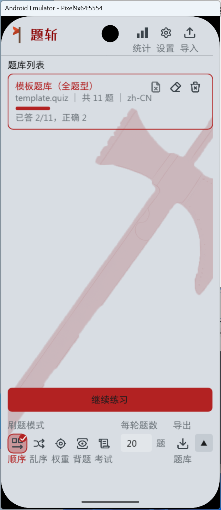
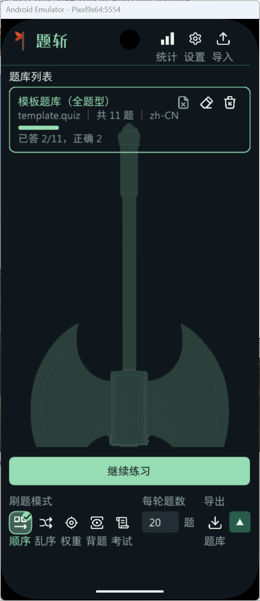
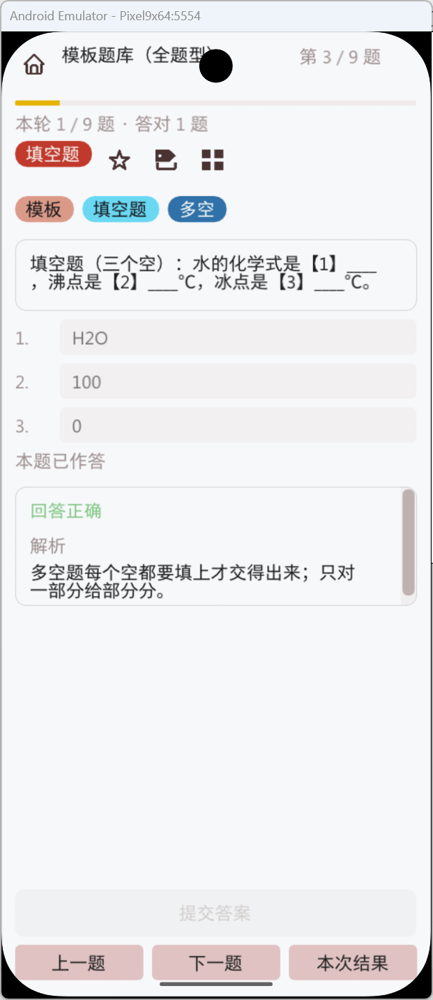
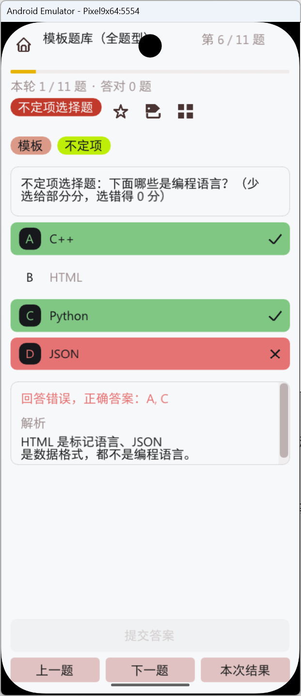
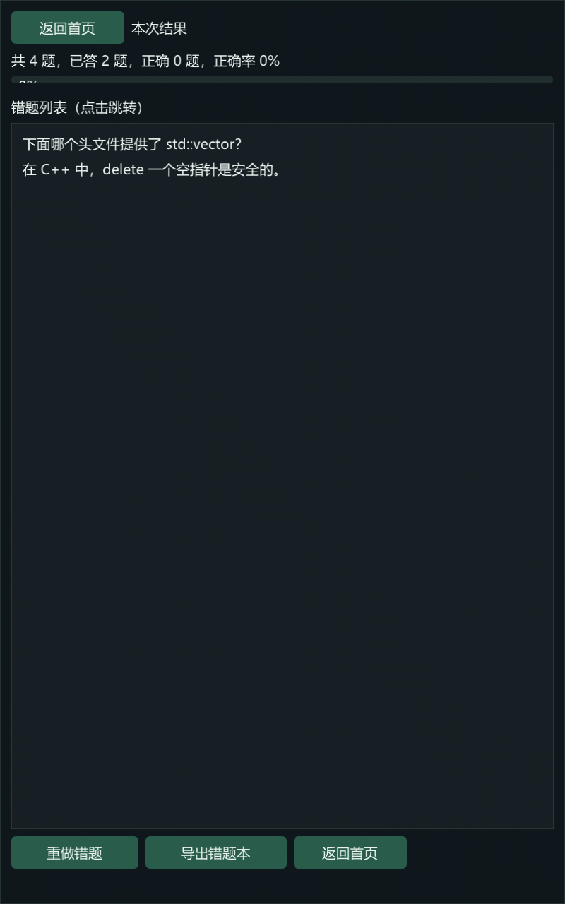
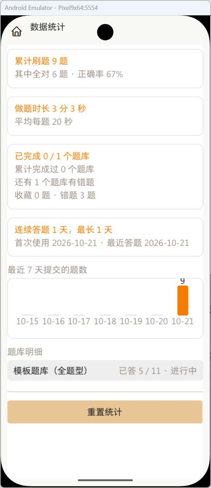

# 题斩（AxeQuiz）

中文名“题斩”，英文名“AxeQuiz”，项目兜底名“AxtUebung”。

命名规则见 [docs/命名规范.md](docs/命名规范.md)。

一个本地优先、离线运行的刷题应用。Windows 与 Android 共用同一套 C++ 核心，支持固定格式题库、多种刷题模式、材料题、考试模式、进度统计以及通过系统文件选择器导入导出。

**当前版本：0.3.1-alpha（内测中）**<br>
开发者：mh-zy（@gcw_7wG3NXCK）<br>
联系邮箱：jytc4399@163.com<br>
开源仓库：[AtomGit](https://atomgit.com/gcw_7wG3NXCK/AxtUebing)





## 特点

- **纯本地**：应用本身不联网，没有账号、广告、统计上报或云同步。
- **跨端核心**：Windows 与 Android 共用 C++17 业务核心和 Dear ImGui 界面。
- **题型完整**：单选、多选、判断、填空、不定项、多项有序、材料题。
- **刷题模式**：顺序、乱序、权重、背题、错题训练、考试。
- **题库导入导出**：Windows 系统对话框；Android SAF，不需要广泛存储权限。
- **进度与统计**：本地保存作答次数、对错、收藏、标签、累计统计。
- **个性化**：主题配色、首页背景、界面比例、语言包、正文字体与独立品牌标题字体、提示词。
- **答题操作**：底部提交与翻题栏固定，正文独立滚动，不再随题目长度上下移动。
- **公开提示词**：中文/英文题库格式修正提示词随源码发布，便于批量整理题库。
- **触屏手势**：列表任意位置拖动、控件起手纵向拖动、惯性滚动。

更多截图：

| 刷题                          | 部分正确                        | 结果                            | 统计                           |
| --------------------------- | --------------------------- | ----------------------------- | ---------------------------- |
|  |  |  |  |

## 平台状态

| 平台      | 状态                           |
| ------- | ---------------------------- |
| Android | 主要使用目标；0.2.2 已在模拟器验证首页与设置主题页 |
| Windows | 共用核心与测试开发端                   |

Windows 版适合开发、题库制作和桌面使用；正式内测以 Android 为主。

## 下载

正式下载地址和发布包将在内测开始后提供。当前源码可直接自行构建。

发布二进制时建议同时提供：

- 对应版本源码标签；
- APK 或 Windows 压缩包；
- SHA-256 校验值；
- 签名与安装说明；
- 本版本更新日志。

## 从源码构建

### 环境要求

- C++17 编译器；
- CMake 3.22 或更高版本；
- Ninja；
- Windows：Visual Studio，安装“使用 C++ 的桌面开发”；
- Android：JDK、Android SDK、NDK `30.0.16248370`；
- Android Gradle Plugin `9.4.1`，Gradle Wrapper `9.8.0`，编译 SDK 37，最低 Android 7.0（API 24）。

### Windows

```powershell
git clone https://atomgit.com/gcw_7wG3NXCK/AxtUebing.git
cd AxtUebung
powershell -ExecutionPolicy Bypass -File tools\build-windows.ps1 -RunTests
.\build\win\bin\AxtQuiz.exe
```

Release 构建：

```powershell
powershell -ExecutionPolicy Bypass -File tools\build-windows.ps1 -Config Release
```

### Android

先设置 SDK 与 JDK 路径。脚本也支持通过 `-JavaHome`、`-SdkRoot` 显式传入：

```powershell
$env:JAVA_HOME = '<JDK path>'
$env:ANDROID_HOME = '<Android SDK path>'

powershell -ExecutionPolicy Bypass -File tools\build-android.ps1
```

安装到已连接设备或模拟器：

```powershell
powershell -ExecutionPolicy Bypass -File tools\build-android.ps1 -Install
```

> 当前仓库的 Gradle 配置使用国内镜像并带官方 SHA-256 校验。海外网络环境可将 `gradle/wrapper/gradle-wrapper.properties` 改回 `services.gradle.org`，并视需要调整 `settings.gradle.kts` 的仓库顺序。

> 当前 `release` 构建配置使用本机 Android 调试密钥，仅适合侧载测试。公开二进制发行前应替换为项目自己的签名密钥，且不得把 keystore 或密码提交到仓库。

修改根目录 `axt-app-icon.png` 后，重新生成 Android 桌面图标：

```powershell
powershell -ExecutionPolicy Bypass -File tools\build-app-icons.ps1
```

### 发布打包与 AtomGit 上传

预览发布流程，不构建、不写文件：

```powershell
powershell -ExecutionPolicy Bypass -File tools\release.ps1 -DryRun -AllowDirty
```

生成发布包：

```powershell
powershell -ExecutionPolicy Bypass -File tools\release.ps1 -ExpectedVersion 0.2.3
```

脚本默认要求 `Version.h` 与 `app/build.gradle.kts` 的版本一致、Git 工作区干净，并生成：

```text
dist\AxtUebung-<version>.apk
dist\AxtUebung-<version>-windows-x64.zip
dist\AxtUebung-<version>-SHA256SUMS.txt
dist\AxtUebung-<version>-RELEASE.md
```

上传提交和标签到 AtomGit：

```powershell
powershell -ExecutionPolicy Bypass -File tools\upload-atomgit.ps1 `
  -StageAll -Message "Release 0.2.3" -Tag v0.2.3 -RunTests
```

上传脚本不会强推，也不会自动暂存，除非明确写 `-StageAll`。它只推送 Git 提交与标签；APK、ZIP 等二进制附件仍需在 AtomGit 的发布页单独上传。

## 使用

普通用户请先阅读 [用户手册.txt](用户手册.txt)。

1. 在首页选择题库；
2. 选择顺序、乱序、权重、背题或考试模式；
3. 提交答案后查看判定与解析；
4. 在结算页查看本轮结果和错题；
5. 通过导出按钮备份题库、错题、收藏题或标签题。

Android 导入和导出使用系统文件选择器。应用只访问用户主动选择的文件，不申请广泛外部存储权限。

## 题库格式

题库是 UTF-8 纯文本，采用 INI 风格结构：

```ini
[meta]
id = my-bank
title = 我的题库
lang = zh-CN

[q]
type = single
stem = 1 + 1 = ?
option = 1
option = 2
answer = B
analysis = 1 + 1 = 2
```

完整语法、材料题、考试卷声明、分值、标签和难度说明见：

- [题库格式](docs/题库格式.md)
- [考试模式设计](docs/考试模式设计.md)
- [主题配色格式](docs/主题配色格式.md)

Windows 命令行可以校验题库：

```powershell
.\build\win\bin\AxtQuiz.exe --validate <path-to-bank.quiz>
```

公开的题库整理提示词：

- [中文提示词](assets/prompt/prompt-cn.txt)
- [English prompt](assets/prompt/prompt-en.txt)

## 本地数据

| 内容   | Windows                    | Android                         |
| ---- | -------------------------- | ------------------------------- |
| 用户题库 | `<程序目录>/data/banks/`       | 应用私有目录 `files/banks/`           |
| 进度   | `<程序目录>/data/progress/`    | 应用私有目录 `files/progress/`        |
| 导出   | `<程序目录>/data/export/`      | 应用私有目录 `files/export/` 或用户选择的位置 |
| 设置   | `<程序目录>/data/settings.txt` | 应用私有目录 `files/settings.txt`     |

卸载或清除应用数据会删除本地进度。重要题库和进度请先导出备份。

隐私细节见 [PRIVACY.md](PRIVACY.md)。

## 隐私摘要

- 应用本身不联网；
- 不收集账号、设备标识、广告标识或统计信息；
- 不接入崩溃上报或推送 SDK；
- 题库、进度和设置保存在本机；
- Android 已关闭系统备份（`android:allowBackup="false"`），卸载或清除数据后不会由系统自动恢复。

完整说明见 [PRIVACY.md](PRIVACY.md)。

## 项目结构

```text
core/        平台无关业务核心：题库、判分、会话、进度、统计、语言包
ui/          Dear ImGui 界面与页面状态
render/      软件渲染后端、SVG 读取与纹理
platform/    Windows 与 Android 平台层
app/         Android Gradle 壳与 Java 输入法/SAF 桥
assets/      语言包、字体、图标、主题和公开提示词；公开版不附带题库
tests/       核心单元测试
tools/       构建与发布脚本
docs/        格式、架构和实现说明
third_party/ 第三方源码
```

架构和扩展点见 [docs/架构说明.md](docs/架构说明.md)。

## 参与贡献

提交代码前请阅读 [CONTRIBUTING.md](CONTRIBUTING.md)。安全问题请按 [SECURITY.md](SECURITY.md) 私下报告，不要在公开 Issue 中先披露利用细节。

公开发布和二进制发行前的检查项见 [docs/发布前检查清单.md](docs/发布前检查清单.md)。

## 第三方许可

本项目使用 Dear ImGui、stb、Tabler Icons、Lucide、Noto Sans SC、Kotlin stdlib 和 Android NDK 等第三方组件。许可证与版权信息见 [THIRD_PARTY_NOTICES.md](THIRD_PARTY_NOTICES.md) 和 `LICENSES/`。

## 许可证

本项目源代码和原创资源采用 MIT License，见 [LICENSE](LICENSE)。第三方组件继续适用其各自许可证。

## 免责声明

本软件按“现状”提供，不保证题库解析、判分、导入导出或数据存储绝对无误。使用前请自行备份重要题库和进度。MIT 许可证中的免责条款适用于本软件。

## 反馈

- 邮箱：jytc4399@163.com
- Issue：https://atomgit.com/gcw_7wG3NXCK/AxtUebing/issues
- 内测说明：[BETA_TESTING.md](BETA_TESTING.md)

## 引用与商用通知

强烈建议在文章、课程、项目文档或衍生作品中引用本项目时致谢维护者 **mh-zy（@gcw_7wG3NXCK）**。

强烈建议在商业产品、服务或商业部署中引用本项目时，提前发送邮件至 **jytc4399@163.com** 通知维护者。

这两项是维护者的强烈请求，不是 MIT License 之外的附加法律条件。详见 [NOTICE.md](NOTICE.md)。
