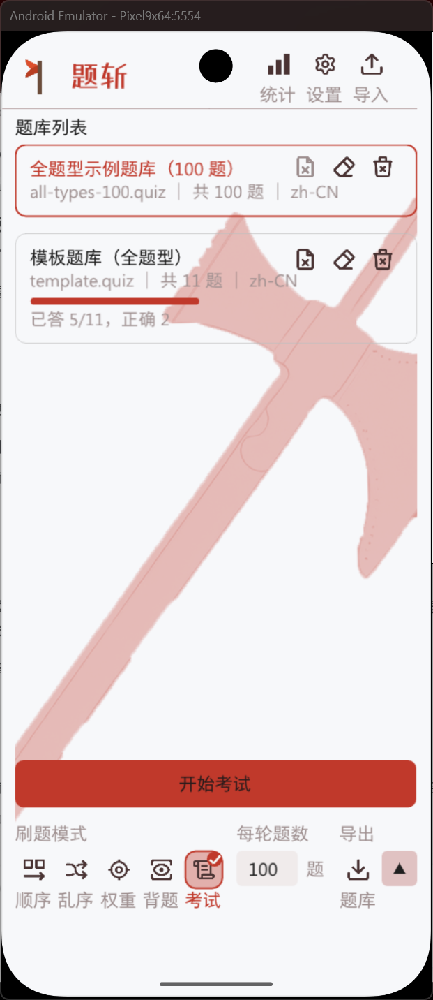
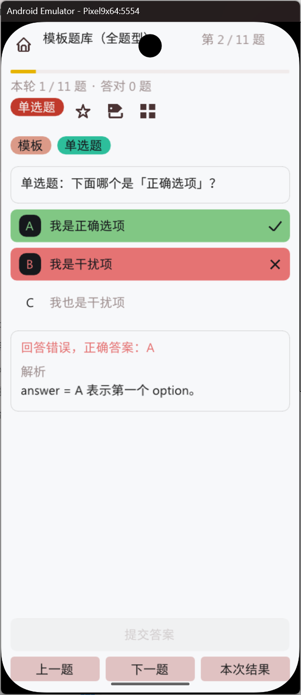
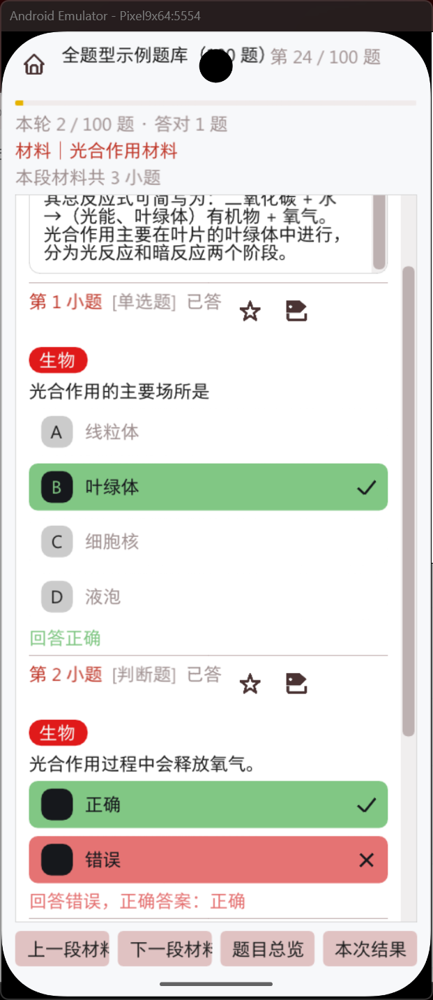
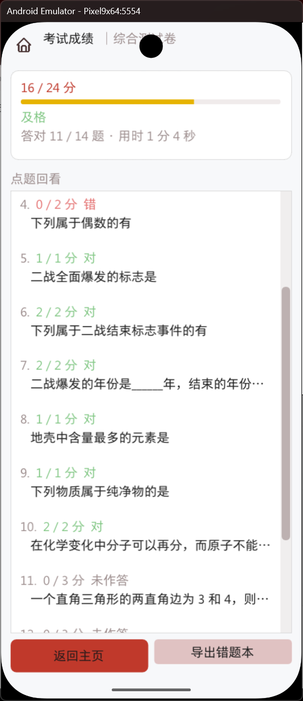
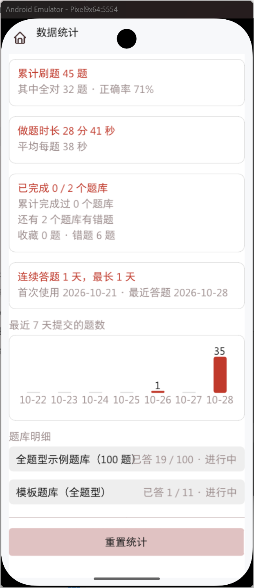
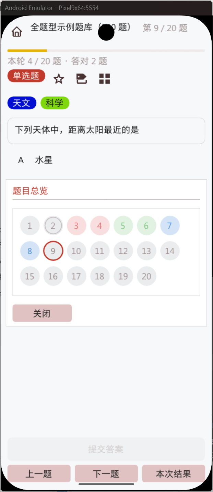

# 题斩（AxeQuiz）

一款本地优先、离线运行的刷题应用。题库、进度、统计和设置保存在用户设备上，不需要账号，也不依赖云服务。

Windows 与 Android 共用同一套 C++17 核心，支持多种题型、练习模式、材料题、考试、错题管理以及题库导入导出。

**版本：1.0.0** · **平台：Android / Windows** · **许可证：MIT**

[AtomGit 仓库](https://atomgit.com/gcw_7wG3NXCK/AxtUebing) ·
[GitHub 仓库](https://github.com/mh-zy/AxtUebung) ·
[AtomGit Issues](https://atomgit.com/gcw_7wG3NXCK/AxtUebing/issues) ·
[GitHub Issues](https://github.com/mh-zy/AxtUebung/issues)

## 下载与安装

从发布页下载与设备对应的最新版本：

- [AtomGit Releases](https://atomgit.com/gcw_7wG3NXCK/AxtUebing/releases)
- [GitHub Releases](https://github.com/mh-zy/AxtUebung/releases)

| 平台 | 产物 | 安装说明 |
| --- | --- | --- |
| Android | APK | 支持 Android 7.0 及以上；安装后通过系统文件选择器导入题库 |
| Windows | ZIP | 解压完整目录后运行 `AxtQuiz.exe`，不要只复制可执行文件 |

发布页同时提供 SHA-256 校验清单。首次导入重要题库前，建议先保留原始文件副本。

## 界面预览

| 首页 | 刷题 | 材料题 |
| :---: | :---: | :---: |
| [](docs/images/1-home-1.0.0.png) | [](docs/images/2-practice-1.0.0.png) | [](docs/images/3-material-1.0.0.png) |
| **考试成绩** | **数据统计** | **题目总览** |
| [](docs/images/4-exam-result-1.0.0.png) | [](docs/images/5-stats-1.0.0.png) | [](docs/images/6-overview-1.0.0.png) |

## 主要功能

- **离线与本地数据**：无账号、无广告、无统计上报；题库、进度和设置保存在用户设备上。
- **完整题型**：单选、多选、判断、填空、不定项、多项有序和材料题。
- **多种模式**：顺序、乱序、智能、背题、错题训练和考试。
- **考试模式**：试卷选择、准备页、倒计时、草稿修改、交卷判分和逐题成绩。
- **题库读写**：支持纯文本题库和 Word 系列文档导入；可导出整库、错题、收藏题和标签题。
- **学习与界面**：错题本、收藏、标签、统计、主题配色、首页背景、界面比例、中英文界面和使用手册。

## 快速开始

1. 安装应用并打开首页；
2. 点击右上角导入按钮，选择题库文件；
3. 选择题库和刷题模式；
4. 作答后查看判定、解析和统计；
5. 定期导出题库和进度，避免设备故障或误删除造成数据丢失。

完整操作说明见 [用户手册.txt](用户手册.txt)。

## 题库与提示词

题库采用 UTF-8 纯文本和 INI 风格结构：

```ini
[meta]
id = example-bank
title = 示例题库
lang = zh-CN

[q]
id = q1
type = single
stem = 1 + 1 = ?
option = 1
option = 2
answer = B
analysis = 1 + 1 = 2
```

详细说明：

- [题库格式](docs/题库格式.md)
- [考试模式设计](docs/考试模式设计.md)
- [数学公式兼容范围](docs/数学公式兼容方案.md)
- [主题配色格式](docs/主题配色格式.md)

题库整理提示词可在应用内复制或下载：

- [中文提示词](assets/prompt/prompt-cn.txt)
- [English prompt](assets/prompt/prompt-en.txt)

## 数据与隐私

- 应用本身不访问互联网，不收集账号、设备标识、广告数据或统计数据。
- 反馈按钮只在用户主动操作时打开系统浏览器或将 URL 写入剪贴板。
- Android 导入导出使用系统文件选择器，不申请广泛外部存储权限。
- 卸载应用或清除应用数据会删除本地进度，请提前使用应用内导出功能备份。

完整说明见 [PRIVACY.md](PRIVACY.md)。

## 反馈

提交问题前请先搜索已有 Issue，并附上：

- 应用版本和设备平台；
- 系统版本与设备型号；
- 复现步骤；
- 实际结果和期望结果；
- 必要日志或截图，注意移除私人题库名称和本地路径。

- [AtomGit Issues](https://atomgit.com/gcw_7wG3NXCK/AxtUebing/issues)
- [GitHub Issues](https://github.com/mh-zy/AxtUebung/issues)

安全问题请先阅读 [SECURITY.md](SECURITY.md)，不要在公开 Issue 中提前披露可直接利用的细节。

## 开发与文档

- [贡献指南与构建方式](CONTRIBUTING.md)
- [架构说明](docs/架构说明.md)
- [发布前检查清单](docs/发布前检查清单.md)
- [更新日志](CHANGELOG.md)

## 许可与致谢

项目源代码与原创资源采用 [MIT License](LICENSE)。第三方字体、图标和库继续适用各自许可证，详见 [THIRD_PARTY_NOTICES.md](THIRD_PARTY_NOTICES.md) 和 `LICENSES/`。

欢迎在文章、课程或衍生作品中致谢项目维护者。商业使用通知为维护者的强烈请求，不是 MIT License 之外的附加法律条件，详见 [NOTICE.md](NOTICE.md)。

## 免责声明

本软件按“现状”提供，不保证题库解析、判分、导入导出或数据存储绝对无误。重要题库和答题进度请定期导出备份；MIT License 中的免责条款适用于本软件。
